# cobos-post1-u6: Instrucciones y modos de direccionamiento en NASM sobre DOSBox

- **Curso:** Arquitectura de Computadores (1154507-B), Universidad Francisco de Paula Santander
- **Estudiante:** Isabella Cobos Lizarazo (1152507)
- **Unidad 6:** Post-contenido. Instrucciones x86 y modos de direccionamiento, verificados con DEBUG

Este repositorio documenta un laboratorio de dos partes realizado en DOSBox 0.74-3 con NASM 2.16.03 y el depurador DEBUG. La **Parte 1** (`lab6_instrucciones.asm`) recorre las cuatro categorías de instrucciones x86 (transferencia, aritmética, lógica y control de flujo) y un quinto bloque que contrasta las rotaciones `ROL` y `ROR` con los desplazamientos `SHL` y `SHR`. La **Parte 2** (`lab6_modos.asm`) aísla los modos de direccionamiento inmediato, directo, indirecto por registro e indexado, y los extiende con un marco de variables locales con `BP` y con el acceso a una matriz de 3×3 con doble indexación.

Todas las capturas se tomaron con la función de captura propia de DOSBox (Ctrl+F5), que guarda la pantalla emulada de 640×400 tal como se ve.

## Estructura del repositorio

```
cobos-post1-u6/
├── README.md
├── lab6_instrucciones.asm / .com      Parte 1
├── lab6_factorial.asm / .com          Parte 1, variante del Checkpoint 3
├── lab6_modos.asm / .com              Parte 2
├── lab6_modos_inverso.asm / .com      Parte 2, extensión del Checkpoint 3
└── capturas/                          18 capturas de DOSBox y DEBUG
```

## Entorno y reproducción

| Elemento | Detalle |
|---|---|
| Emulador | DOSBox 0.74-3, carpeta `C:\DOSWork` montada como unidad `C:` con `MOUNT C C:/DOSWork` |
| Teclado | `KEYB LA` (distribución latinoamericana) |
| Ensamblador | NASM 2.16.03 para DOS, formato binario plano (`-f bin`) para generar archivos `.COM` |
| Depurador | `DEBUG.COM` de DOS |

**Nombres de archivo en DOSBox.** DOS solo admite nombres de ocho caracteres más extensión (formato 8.3), y `lab6_instrucciones` tiene dieciocho. Por eso, dentro de DOSBox los archivos se trabajaron con nombres cortos, y el repositorio conserva los nombres que pide la guía con el mismo contenido:

| En el repositorio | En DOSBox |
|---|---|
| `lab6_instrucciones.asm` / `.com` | `lab6ins.asm` / `lab6ins.com` |
| `lab6_factorial.asm` / `.com` | `lab6fac.asm` / `lab6fac.com` |
| `lab6_modos.asm` / `.com` | `lab6mod.asm` / `lab6mod.com` |
| `lab6_modos_inverso.asm` / `.com` | `lab6inv.asm` / `lab6inv.com` |

Los archivos `.com` del repositorio son los generados dentro de DOSBox. Un `.COM` no contiene su nombre, así que son idénticos al renombrarlos.

```
C:\P6> nasm -f bin lab6ins.asm -o lab6ins.com
C:\P6> debug lab6ins.com
```

**Uso de `G` con puntos de interrupción.** El programa de la Parte 1 ejecuta más de ochenta instrucciones antes de llegar al bloque de rotación. Para llegar a cada punto de interés se usó `G <dirección>`, que ejecuta a velocidad normal hasta una dirección y muestra los registros y las banderas allí, y se reservó `T` (una instrucción por paso) para los tramos que se analizan instrucción por instrucción. Las direcciones salen del listado de NASM (`-l`) sumando 100h, porque el programa comienza en `org 100h`.

# Parte 1: Instrucciones de transferencia, aritmética, lógica, control de flujo y rotación

## Bloques del programa

| Bloque | Instrucciones | Propósito | Resultado esperado |
|---|---|---|---|
| 1. Transferencia | `MOV`, `LEA`, `XCHG`, `PUSH`, `POP` | Cargar valores, obtener una dirección (no su contenido) e intercambiar y preservar registros | `AX=45`, `BX=12`, `SI` = dirección de `valor_a` |
| 2. Aritmética | `ADD`, `SUB`, `INC`, `DEC`, `MUL`, `DIV` | Operar sobre los valores y observar las banderas | `AX=57`, luego `-33`; `MUL`: `AX=70`; `DIV`: `AL=14`, `AH=2` |
| 3. Lógica | `AND`, `OR`, `XOR`, `TEST`, `SHL`, `SHR` | Limpiar, activar e invertir bits, poner a cero un registro y probar un bit | `AL=07h`, `F7h`, `55h`; `TEST` deja `ZF=0`; `AL=10h` |
| 4. Control de flujo | `CMP`, `JG`, `JE`, `JMP`, `LOOP` | Decidir con una comparación con signo y sumar de 1 a 5 con un bucle | `CX=1`; `AX=15` al terminar el bucle |
| 5. Rotación | `SHL`, `ROL`, `SHR`, `ROR` | Contrastar descartar un bit con reinsertarlo, e intercambiar nibbles | `BL=02h`, `CL=03h`, `DL=40h`, `BH=C0h`, `AL=5Ah` |

El programa es un `.COM` de un solo segmento: comienza con `org 100h`, salta con `jmp inicio` sobre los datos y termina con `INT 20h`.

## Checkpoint 1: Compilación exitosa

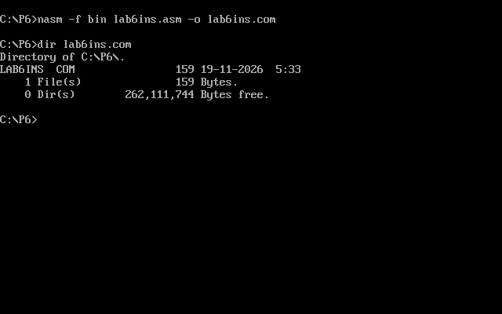

NASM ensambló sin errores ni advertencias y generó `lab6ins.com` de 159 bytes.

## Checkpoint 2: Ejecución y verificación de banderas

Se cargó `lab6ins.com` en DEBUG. Las dos capturas siguientes muestran los registros y las banderas inmediatamente después de cada instrucción pedida, con puntos de interrupción de `G`.

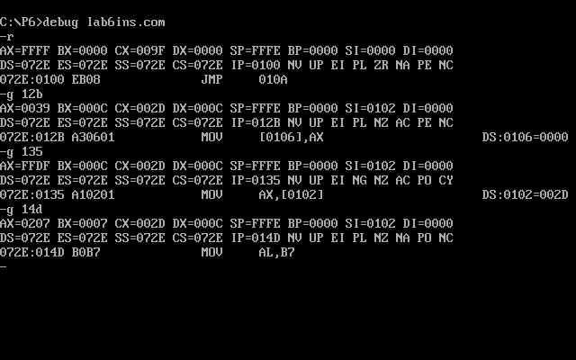

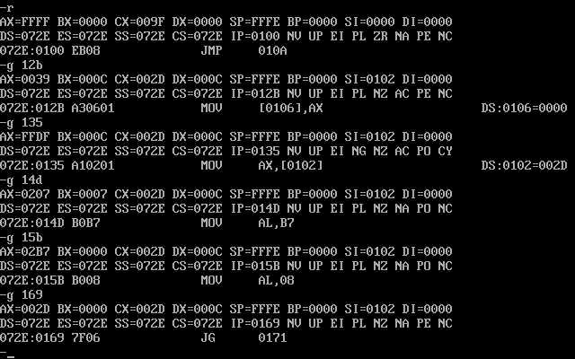

| Instrucción | Registro tras ejecutarla | Banderas en DEBUG | CF | ZF | SF | OF |
|---|---|---|---|---|---|---|
| `ADD ax,[valor_b]` | `AX=0039` (57) | `NV UP EI PL NZ AC PE NC` | 0 | 0 | 0 | 0 |
| `SUB ax,[valor_a]` | `AX=FFDF` (−33) | `NV UP EI NG NZ AC PO CY` | 1 | 0 | 1 | 0 |
| `AND al,[mascara]` | `AL=07` | `NV UP EI PL NZ NA PO NC` | 0 | 0 | 0 | 0 |
| `TEST al,01h` | `AL=B7` (sin cambio) | `NV UP EI PL NZ NA PO NC` | 0 | 0 | 0 | 0 |
| `CMP ax,[valor_b]` | `AX=002D` (sin cambio) | `NV UP EI PL NZ NA PE NC` | 0 | 0 | 0 | 0 |

`SUB` activa `CF` (hubo préstamo, porque 12 es menor que 45 sin signo) y `SF` (el resultado es negativo). `AND` y `TEST` siempre limpian `CF` y `OF`. `TEST` deja `ZF=0` porque el bit 0 de `B7h` vale 1. `CMP` resta sin guardar el resultado: 45 − 12 = 33, positivo, y por eso `JG` salta.

Luego se trazaron tres instrucciones con `T` a partir del `CMP` y se ejecutó hasta el final del bucle:

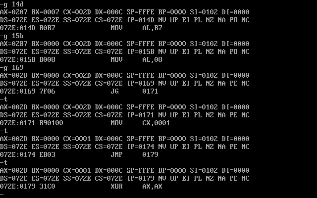

Los tres pasos muestran `JG` (salta a la etiqueta `.mayor`), `MOV cx,1` (`CX=0001`) y `JMP .fin_cmp`. Después del bucle, la segunda captura muestra `AX=000F` (15):

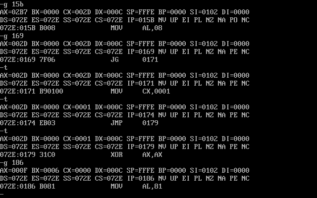

## Checkpoint 3: Variante factorial

`lab6_factorial.asm` reemplaza `ADD` por `MUL` en el bucle: `AX` parte en 1, `CX` en 5 y `BX` en 1, y cada vuelta multiplica `AX` por `BX` e incrementa `BX`. La secuencia de productos es 1·1, 1·2, 2·3, 6·4 y 24·5. `MUL bx` deja el producto en `DX:AX`; como 120 cabe en 16 bits, `DX` permanece en 0.

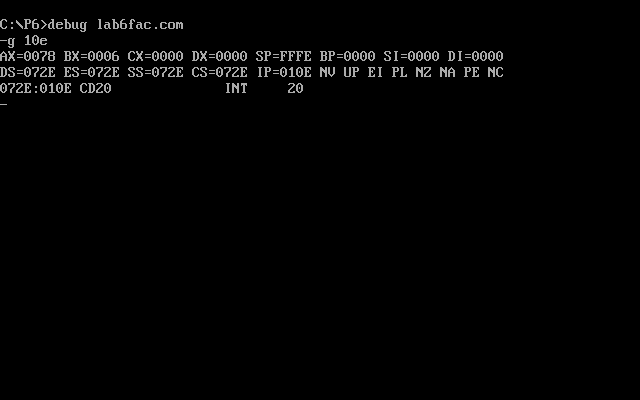

`AX=0078` es 120 en hexadecimal, que es 5!.

## Checkpoint 4: Rotación verificada

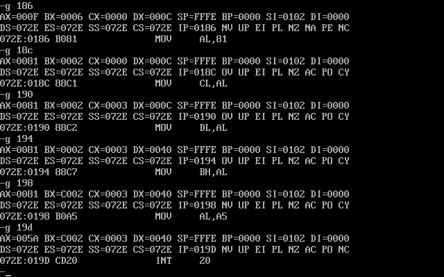

| Instrucción | Entrada | Resultado | CF | Observación |
|---|---|---|---|---|
| `SHL bl,1` | `81h` | `BL=02h` | 1 | El bit 7 se perdió; solo queda en `CF` |
| `ROL cl,1` | `81h` | `CL=03h` | 1 | El mismo bit reapareció como bit 0 |
| `SHR dl,1` | `81h` | `DL=40h` | 1 | El bit 0 se perdió |
| `ROR bh,1` | `81h` | `BH=C0h` | 1 | El bit 0 reapareció como bit 7 |
| `ROL al,4` | `A5h` | `AL=5Ah` | — | Los nibbles quedaron intercambiados |

## Decisiones técnicas de la Parte 1

### ¿SHL/SHR o ROL/ROR?

`SHL` y `SHR` son la elección correcta cuando la operación es aritmética: desplazar un bit a la izquierda multiplica por 2 y a la derecha divide por 2, y el bit que sale del registro no forma parte del resultado numérico. En el Bloque 3, `SHL al,2` convirtió 8 en 32 y `SHR al,1` lo llevó a 16, sin que el bit descartado importara. `ROL` y `ROR` son la elección cuando el contenido del registro debe conservarse completo, como en el intercambio de nibbles o en un checksum circular. La diferencia se vio con `AL=81h`: tras `SHL al,1` el bit 7 original (1) desaparece del registro y solo queda visible en `CF`, mientras que tras `ROL al,1` el mismo bit reaparece como el nuevo bit 0. `SHL` nunca podría intercambiar los nibbles de un byte, aplicada cuantas veces se quiera, porque cada desplazamiento descarta el nibble alto en vez de reubicarlo, y ni siquiera un `OR` posterior recuperaría la información perdida. `ROL al,4` lo logra en una sola instrucción: convirtió `A5h` en `5Ah`.

### ¿LOOP o DEC/JNZ?

`LOOP` combina en una instrucción el decremento de `CX` y el salto si `CX` no es cero, lo que hace el bucle más compacto y legible: ocupa 2 bytes (`E2FB` en el desensamblado) frente a 1 byte de `DEC CX` más 2 de `JNZ`. Aun así, el número de instrucciones escritas no mide cuánto tarda la ejecución: cada instrucción tiene su propio costo de decodificación y ejecución. En el 8086 original `LOOP` era algo más barata que la pareja `DEC`/`JNZ`, pero en los procesadores posteriores, y de forma muy marcada en los modernos, `LOOP` suele ser más lenta porque se decodifica en varias micro-operaciones mientras que `DEC` y `JNZ` son sencillas y se fusionan. Para el bucle de 5 iteraciones del Bloque 4 la diferencia es imperceptible: son unas pocas decenas de ciclos. Sí importaría si el bucle se ejecutara millones de veces dentro de un programa mayor, donde la secuencia `DEC`/`JNZ` sería preferible por rendimiento aunque cueste una instrucción más de leer.

# Parte 2: Modos de direccionamiento

El programa `lab6_modos.asm` define un array de cinco enteros de 16 bits, un registro de tres campos (`nota1`, `nota2`, `promedio`), una variable `var_x` y una matriz de 3×3, y accede a ellos con un modo de direccionamiento distinto en cada bloque. Los datos quedan al principio del `.COM`, justo después del `jmp inicio` de 2 bytes, así que `array` está en el desplazamiento 0102h.

Compilación del programa en DOSBox (`lab6mod.com` de 174 bytes, sin errores ni advertencias):

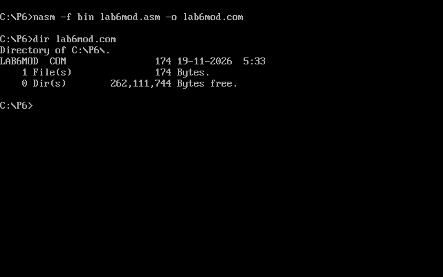

## Tabla de modos de direccionamiento

| Modo | Dirección efectiva | Instrucción NASM usada | Valor observado en DEBUG |
|---|---|---|---|
| Inmediato | No hay acceso a memoria: el dato va en la instrucción | `mov ax, 100` | `U` lo muestra como `MOV AX,0064` (bytes `B8 64 00`) |
| Directo | Dirección fija: `[desplazamiento]` | `mov ax, [var_x]` | `DS:0112=FFFF` |
| Indirecto por registro | `[SI]` | `mov ax, [si]` con `SI=010C` | `AX=0055` (85) |
| Indexado | `[BX + SI]` | `mov ax, [bx + si]` | Suma del array: `AX=0096` (150) |
| Indirecto por `BP` | `SS:[BP − 2]`, `SS:[BP − 4]` | `mov ax, [bp - 2]` | `SS:FFFA=0063`, `SS:FFF8=00FA`; `AX=015D` (349) |
| Doble indexación | `base + fila·ancho·2 + columna·2` | `mov dx, [bx + si]` con `SI=000Ah` | `DX=0006` (`matriz[1][2]`) |

## Modos inmediato y directo

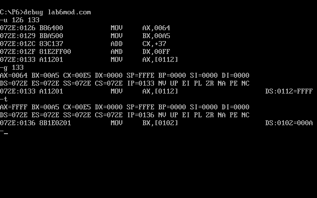

El comando `U 126 133` desensambla las cuatro instrucciones del modo inmediato: el valor aparece dentro de la propia instrucción (`MOV AX,0064`, `MOV BX,00A5`, `ADD CX,+37`, donde 37h es 55, y `AND DX,00FF`). La instrucción siguiente, `MOV AX,[0112]`, es de modo directo: lleva la dirección absoluta de `var_x`, y al ejecutarla con `T` DEBUG muestra `DS:0112=FFFF` y deja `AX=FFFF`.

## Checkpoint 1: Estructura de datos en memoria

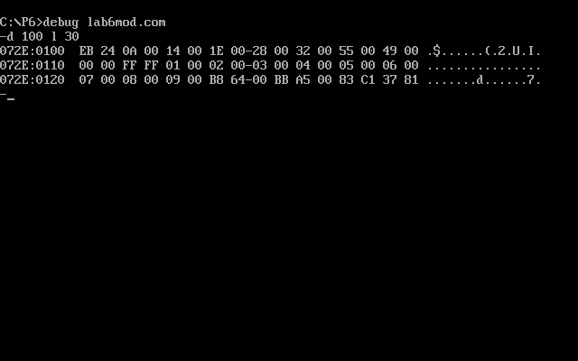

El comando `D 100 L 30` muestra en la primera fila `EB 24` (el `jmp inicio`) y a continuación, en orden little-endian, `0A 00 14 00 1E 00 28 00 32 00`, que son 10, 20, 30, 40 y 50; después `55 00` (`nota1` = 85) y `49 00` (`nota2` = 73). Las dos filas siguientes contienen `promedio` (00 00), `var_x` (FF FF) y los nueve elementos de la matriz (1 a 9).

## Checkpoint 2: Traza del modo indirecto

Se llegó con `G 144` al bloque indirecto y se trazaron sus ocho instrucciones con `T`.

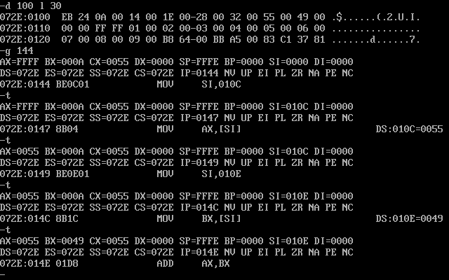

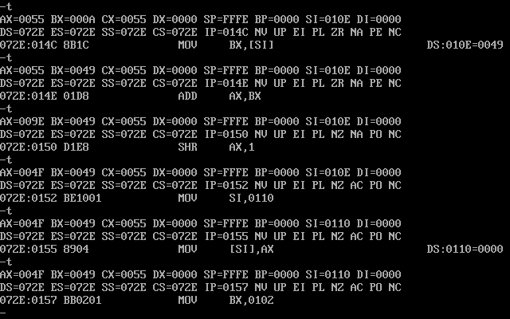

| Instrucción | Registro modificado | Valor resultante |
|---|---|---|
| `mov si, nota1` | `SI` | `0000` → `010C` (dirección de `nota1`) |
| `mov ax, [si]` | `AX` | `0055` (85, el contenido de `nota1`) |
| `mov si, nota2` | `SI` | `010E` (dirección de `nota2`) |
| `mov bx, [si]` | `BX` | `0049` (73) |
| `add ax, bx` | `AX` | `009E` (158) |
| `shr ax, 1` | `AX` | `004F` (79, el promedio) |
| `mov si, promedio` | `SI` | `0110` (dirección de `promedio`) |
| `mov [si], ax` | memoria `DS:0110` | `004F`; `D 110 L 2` muestra `4F 00` |

## Checkpoint 3: Modo indexado y extensión

El bucle `add ax, [bx + si]` con `SI` avanzando de 2 en 2 suma los cinco elementos:

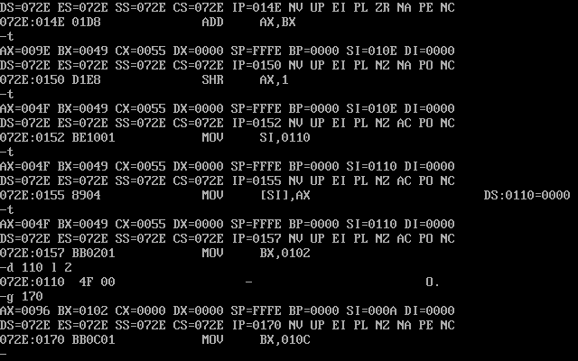

La extensión `lab6_modos_inverso.asm` recorre el array de atrás hacia adelante: `SI` parte en 8 (índice del último elemento por 2 bytes) y cada iteración lo reduce con `sub si, 2`. El resultado es el mismo, porque la suma es conmutativa:

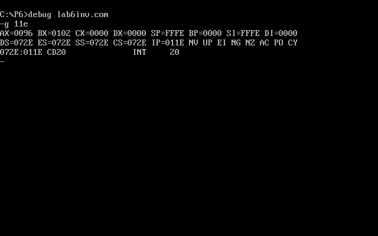

## Checkpoint 4: Marco de pila con BP

El bloque guarda `BP`, lo iguala a `SP`, reserva 4 bytes con `sub sp, 4` y direcciona las variables locales como desplazamientos negativos desde `BP`.

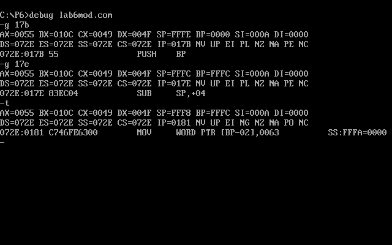

| Momento | SP | BP |
|---|---|---|
| Antes de `push bp` | `FFFE` | `0000` |
| Tras `push bp` y `mov bp, sp` | `FFFC` | `FFFC` |
| Tras `sub sp, 4` | `FFF8` | `FFFC` |
| Tras `mov sp, bp` y `pop bp` | `FFFE` | `0000` |

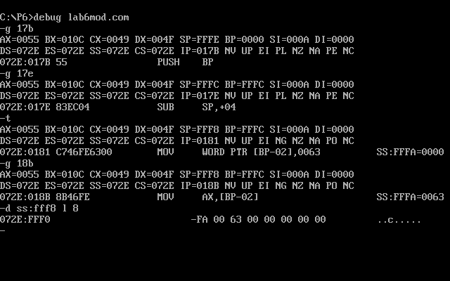

`D SS:FFF8 L 8` muestra `FA 00 63 00`: en `SS:FFF8` está `local_2` = 250 (`00FA`) y en `SS:FFFA` está `local_1` = 99 (`0063`). Tras el `add`, `AX=015D` (349), y al liberar el marco `BP` vuelve a `0000`, el valor que tenía antes de entrar al bloque:

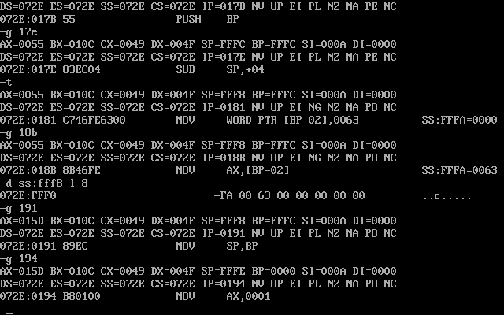

## Checkpoint 5: Acceso a una matriz

Para `matriz[1][2]` el programa calcula primero el desplazamiento de la fila (1 × 3 elementos × 2 bytes = 6), luego el de la columna (2 × 2 bytes = 4), los suma en `SI` (10 = `000Ah`) y lee `[bx + si]` con `BX` apuntando a la matriz (`0114h`).

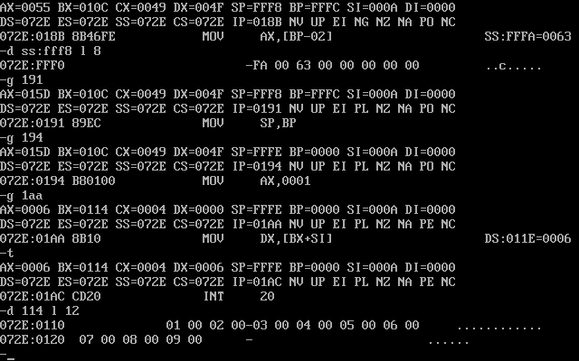

La captura muestra `SI=000A` antes de la lectura, `DX=0006` después de ejecutarla y el volcado de los nueve elementos de la matriz en memoria desde `0114h`.

## Decisiones técnicas de la Parte 2

### ¿Modo directo o indexado para un elemento de posición fija?

Como `matriz[1][2]` es una posición conocida al ensamblar, el modo directo es más eficiente: una sola instrucción, `mov dx, [matriz + 10]`, lleva la dirección ya resuelta dentro del opcode y no gasta ciclos en calcularla. El modo indexado del Checkpoint 5 necesita en cambio un `MUL`, dos `SHL`, un `ADD` y varios `MOV` solo para obtener la dirección efectiva, y `MUL` es una de las instrucciones más costosas del repertorio. Esa diferencia de costo se paga cada vez que se ejecuta el bloque. El modo indexado se vuelve indispensable cuando la fila o la columna no se conocen al compilar sino que dependen de una variable calculada en ejecución, por ejemplo el índice de un bucle que recorre la matriz. Para sumar las nueve posiciones, usar direccionamiento directo exigiría nueve instrucciones casi idénticas, una por elemento, que habría que reescribir si cambiara el tamaño de la matriz, mientras que un solo bucle indexado hace lo mismo con unas pocas instrucciones y se adapta a cualquier tamaño.

### ¿BP o BX/SI en direccionamiento indirecto?

La arquitectura x86 asigna a cada registro base un segmento por defecto: `BX`, `SI` y `DI` apuntan al segmento de datos (`DS`), mientras que `BP` apunta al segmento de pila (`SS`). La convención existe para que `BP` sirva de ancla estable del marco de pila (variables locales y parámetros de un procedimiento), sin interferir con los punteros a datos que se mueven durante el programa. En este laboratorio la diferencia no se nota porque un `.COM` tiene un solo segmento y `DS=SS=CS`, como muestran las capturas, donde todos valen `072E`. En un `.EXE` con `DS` distinto de `SS`, en cambio, suponer que `[bp + desplazamiento]` y `[bx + desplazamiento]` apuntan al mismo lugar produciría lecturas o escrituras en el segmento equivocado, con datos incorrectos o corrupción de memoria. Para forzar que una instrucción basada en `BP` use `DS` se escribe un prefijo de sobrescritura de segmento, por ejemplo `mov ax, [ds:bp+2]`. Tendría sentido, por ejemplo, para leer con `BP` un dato global del segmento de datos desde dentro de un procedimiento con marco de pila.

## Resumen de commits

El historial sigue el orden del laboratorio: bloques de instrucciones, rotación y variante factorial en la Parte 1; modos de direccionamiento, recorrido inverso, marco `BP` y matriz en la Parte 2; y la documentación al final.
